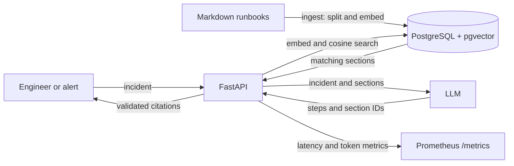

# CloudOps Copilot

An incident-troubleshooting API that retrieves sections of your team's Markdown runbooks and asks an LLM to produce cited remediation steps. This is a starter project: the example runbooks need review, and the cloud deployment needs access controls and operational validation before production use.



## Start locally

You need Docker Desktop with Compose, an OpenAI API key with access to the configured embedding and chat models, and provider billing enabled if required. Calls to the provider can cost money. These commands use PowerShell from the project root:

```powershell
Copy-Item .env.example .env
# Edit .env and set OPENAI_API_KEY. Never commit this file.
docker compose up --build -d
Invoke-RestMethod http://localhost:8000/healthz
Invoke-RestMethod -Method Post http://localhost:8000/ingest
Invoke-RestMethod -Method Post http://localhost:8000/diagnose `
  -ContentType 'application/json' `
  -Body '{"incident":"Pod is repeatedly restarting with CrashLoopBackOff"}' | ConvertTo-Json -Depth 10
```

Open [API documentation](http://localhost:8000/docs) or [metrics](http://localhost:8000/metrics). The first ingestion creates the pgvector extension, table and HNSW index and replaces the indexed set transactionally. Rebuild the image and rerun `/ingest` after changing runbooks: Compose copies runbooks into the image. If you change embedding models, reindex; if the vector dimension changes, the existing table must first be recreated, which deletes its index data. The database volume persists after `docker compose down`; `docker compose down -v` also deletes that local data.

Compose binds the API to localhost and uses a development database password. Its password is interpolated into a connection URL, so use a simple URL-safe value for local development. It does not enable API authentication by default. Set `APP_API_KEY` in `.env` and restart Compose to require the `X-API-Key` header for `/ingest` and `/diagnose`. Health and metrics endpoints remain unauthenticated. Do not expose the service or real runbooks without additional authentication, authorization, network restrictions, secret management, and a review of what data may be sent to the LLM provider.

## API and configuration

| Endpoint | Purpose |
| --- | --- |
| `POST /ingest` | Embed all Markdown chunks and replace the index. |
| `POST /diagnose` | Accept `{"incident":"..."}` and return `covered`, `summary`, `remediation_steps`, and citations with filename, section and chunk ID. |
| `GET /healthz` | Check database connectivity for readiness. |
| `GET /livez` | Check the API process for liveness. |
| `GET /metrics` | Expose Prometheus metrics. |

Retrieval defaults to up to five chunks with cosine distance at most `0.45`. Set `RETRIEVAL_TOP_K` and `RETRIEVAL_MAX_DISTANCE` to calibrate against your own evaluation set. When no chunk passes, or the model produces missing or invalid citation IDs, the API returns `covered: false` with no steps. This is a guardrail, not proof that a step is supported: an engineer must check the cited material before acting.

Configure `PROMPT_COST_PER_MILLION` and `COMPLETION_COST_PER_MILLION` with your provider's current USD prices to enable estimated chat-token cost metrics. They default to zero and do not include embedding costs. Metrics include request duration, database retrieval duration, LLM duration and chat token usage; logs contain request IDs, route, status and duration. Each process exposes its own counters, so scrape each replica and aggregate in Prometheus.

For development without Compose, install Python 3.12+ and run `python -m pip install '.[dev]'`. Set `DATABASE_URL`, `OPENAI_API_KEY` and any other configuration as environment variables or in `.env`, then run `uvicorn app.main:app --host 127.0.0.1 --port 8000`. Optional local embeddings require `python -m pip install '.[local]'`, `EMBEDDING_PROVIDER=local`, and `EMBEDDING_DIMENSIONS=384` for the default `all-MiniLM-L6-v2` model. The model downloads on first use, and diagnosis still uses OpenAI. The Compose image uses OpenAI embeddings and does not include the local model dependencies.

## Evaluation and testing

The 12 example incidents in `evaluation/incidents.json` pair an incident with an expected filename. After ingestion, measure the configured retriever and the final answer separately:

```powershell
docker compose exec api python evaluation/retrieval.py
docker compose exec api python evaluation/evaluate.py --url http://localhost:8000
```

If `APP_API_KEY` is enabled, supply the same value as `CLOUDOPS_EVAL_API_KEY` to the second script (for example with `docker compose exec -e CLOUDOPS_EVAL_API_KEY=<key> ...`). The first script reports the top-three filename hit rate after the distance threshold; the second reports the end-to-end citation filename hit rate. Both use the example dataset, not a production benchmark; the first incurs embedding calls and the second also calls the chat model. No accuracy score is claimed until you run them. Expand the dataset with real, sanitized incidents, review expected citations, and record the measured result and model configuration.

Run offline unit checks after installing development dependencies:

```powershell
python -m ruff check .
python -m pytest
```

## Kubernetes and Azure

`k8s/` contains a Deployment with resource requests and limits, an internal ClusterIP Service and a 70%-CPU HPA. Use kind or minikube with metrics-server for a local trial; load the image into the cluster, configure a reachable PostgreSQL database and the `cloudops-copilot-secrets` Kubernetes Secret (`DATABASE_URL`, `OPENAI_API_KEY`, and optionally `APP_API_KEY`), then update the Deployment image and apply the manifests. Run ingestion after deployment. HPA requires metrics-server and CPU load: LLM calls may be network-bound, so requests alone do not guarantee scaling. Capture actual HPA and metrics output during a controlled load test before making performance claims.

`terraform/environments/dev/` composes network, ACR, AKS and private PostgreSQL modules. Review the configuration and Azure costs first. Install Terraform, Azure CLI and kubectl, sign in to the correct subscription and set `ARM_SUBSCRIPTION_ID`, copy `terraform.tfvars.example` to `terraform.tfvars`, choose globally unique names, and set `TF_VAR_postgres_admin_password` securely. Then run `terraform init`, `terraform fmt -check -recursive ../..`, `terraform validate`, and `terraform plan` from that directory. Review the plan before `terraform apply`. Terraform state contains secrets: use a protected remote backend and do not commit state or credentials. Azure PostgreSQL needs the allowed `vector` extension created by an appropriately privileged database user; ingestion attempts this automatically. Configure the database connection with verified TLS (`sslmode=verify-full` and a trusted CA) and URL-encode credentials. The private database is reachable only from the configured network.

Build and push an image to your ACR, update the Deployment image, obtain AKS credentials, create the Kubernetes secret, and apply the manifests. The default CI pipeline tests Python and validates Terraform; on pushes to `main`, CD publishes a commit-SHA-tagged image to GHCR, not directly to ACR or AKS. AKS needs access to whichever registry hosts the chosen image. No cloud resources are created by this repository until you apply Terraform. AKS, PostgreSQL and related resources incur charges; after preserving anything needed, review and run `terraform destroy` when finished. Destruction deletes the database and its contents.

## Project layout

- `app/`: API, runbook chunking, provider adapters, pgvector persistence and metrics.
- `runbooks/`: twelve sample Kubernetes and cloud operations guides.
- `evaluation/`: example incidents and retrieval/citation evaluation scripts.
- `tests/`: offline tests with mocked external services.
- `k8s/`, `terraform/`, `.github/workflows/`: deployment and automation scaffolding.
